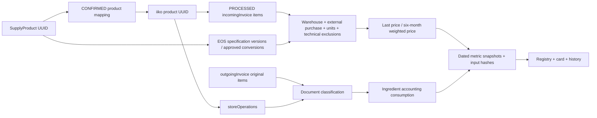
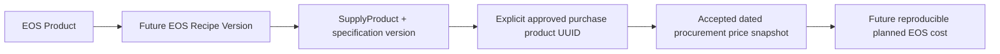

# Stage 3.2 — «Сырьё»: спецификация первого рабочего среза

Дата: 12.10.2026. Статус: **PROPOSED / REVIEW**. Реализация, миграции, изменение прав и deployment не разрешены этим документом.

## 1. Решение и границы

iiko остаётся источником складского учёта и товарных движений. EOS владеет технологическими знаниями, подтверждениями, правилами качества, расчётами аналитических показателей и их историей. Раздел «Сырьё» — представление существующих SupplyProduct с дополнительными знаниями, а не второй товарный справочник или складской ledger.

Первый рабочий срез после отдельного разрешения: ограниченный подтверждённый ассортимент сырья/упаковки, реестр и карточка, ручное обновление через Automation Core, датированные показатели с расшифровкой, безопасное редактирование знаний. Не входит: проведение документов, управление складскими остатками, автозаказ, автозамена, изменение K3/K5C/Sales, массовое создание товаров или новая система планирования производства. Остатки доступны в диагностической расшифровке, но не становятся собственным учётным регистром EOS.

**Зафиксировано владельцем:** iiko — учёт, EOS — знания, SupplyProduct и confirmed UUID mappings — основа. **Предложено для утверждения:** правила периодов/цен, семантика условной единицы, допуск контрагентов, права и приёмочные пороги ниже. Непринятые политики блокируют соответствующий расчёт, а не заполнение остальных разделов карточки.

Источники: [разведка РОСВ](STAGE_3_2_RAW_MATERIALS_ROSV_RESEARCH_2026-10-12.md), [JSON evidence](evidence/STAGE_3_2_RAW_MATERIALS_ROSV_RESEARCH_2026-10-12.json), [архитектурный аудит](STAGE_3_2_PRODUCT_RECIPE_SUPPLY_ARCHITECTURE_AUDIT_2026-10-12.md). Это датированные наблюдения 12 октября, не повторный live audit. В этой задаче production/iiko не опрашивались.

## 2. Проверенная основа и пробелы

| Компонент / файл | Что есть в коде | Переиспользование / пробел |
|---|---|---|
| [models/supply.py](../backend/api/app/models/supply.py), `supply_products` | UUID, tenant, name, iiko_id, default_unit_id, category/storage zone, active/archive, aliases | Стабильная товарная идентичность; нет фото, версионируемой спецификации, подтверждённых исторических коэффициентов |
| Там же, `supply_product_suppliers` | PRIMARY/BACKUP, priority, supplier SKU/name, package quantity/unit, price, availability | Единственный источник назначений поставщиков; одна активная связь product–supplier, один активный PRIMARY. BACKUP может быть несколько |
| `supply_product_supplier_price_history` | MANUAL, effective_from, author, package/base price snapshots | История предложений; не фактическая закупка. RUB здесь не доказывает валюту iiko |
| `supply_supplier_documents`, строки; `supply_supplier_acceptances`, строки; `supply_iiko_incoming_receipts`, строки | Раздельные документы, физическая приёмка, учётный приход | Сохраняются. SupplierOrder/confirmation не становятся закупочным фактом; новый сбор не создаёт acceptance/receipt |
| [models/iiko.py](../backend/api/app/models/iiko.py) | product/unit/supplier mappings и аудит | Только активные CONFIRMED; единичное совпадение UUID не подтверждает упаковочный коэффициент |
| [api/routes/supply.py](../backend/api/app/api/routes/supply.py), [supply/service.py](../backend/api/app/supply/service.py) | Товары, aliases, suppliers, relations, make-primary, price-history | Использовать существующие сервисы; не дублировать CRUD и supplier master |
| [ProductKnowledgePage.tsx](../frontend/src/pages/ProductKnowledgePage.tsx), [ProductManagement.tsx](../frontend/src/pages/productKnowledge/ProductManagement.tsx) | Реестр/карточка продукции, фильтры, статусы | Переиспользовать визуальные паттерны; не связывать сырьё с Sales product identity |
| [product_knowledge/media.py](../backend/api/app/product_knowledge/media.py), [ProductPhoto.tsx](../frontend/src/pages/productKnowledge/ProductPhoto.tsx) | Проверка изображений, приватные immutable blobs, audit, optimistic edits | Переиспользовать нормализацию/безопасность. `mutate/read` привязаны к ProductKnowledgeProduct и его permissions: нельзя вызвать их с SupplyProduct без адаптера |
| [core/authorization.py](../backend/api/app/core/authorization.py), `audit_events` | Tenant/scoped authorization и аудит | Использовать общий механизм; права просмотра каталога Supply не должны автоматически раскрывать цены всем читателям |
| [automation/local_actions.py](../backend/api/app/automation/local_actions.py), [dispatch.py](../backend/api/app/automation/dispatch.py), [outbox.py](../backend/api/app/automation/outbox.py), [schedules.py](../backend/api/app/automation/schedules.py) | Общие executions, outbox, worker, local integration actions, retries | Добавить один тип действия в существующий механизм; не создавать второй scheduler/provider |
| [integrations/iiko/client.py](../backend/api/app/integrations/iiko/client.py) | Существующие авторизация/transport | Новые ограниченные readers и domain adapter по проверенным контрактам, без full-sync |
| [models/product_recipe.py](../backend/api/app/models/product_recipe.py) | Внешние версии/наблюдения K5B | Только чтение UUID листьев сейчас; собственная EOS Recipe Version — будущая работа |

Данные разведки: 164 UUID сентября, 141 уникальная CONFIRMED-связь Supply, 23 без неё. Из 42 листьев пяти сохранённых ТТК 40 присутствовали в движениях. Это не полнота всех ТТК/сырья. Все десять контрольных позиций имеют Supply-связь. Производственный аудит ранее обнаружил лишь три supplier relations и четыре MANUAL history records; наличие модели не гарантирует заполненные поставщики.

## 3. Реестр и карточка

Рекомендуемый route `/raw-materials`, ID строки/карточки — существующий `SupplyProduct.id`. Включение в реестр — явное назначение профиля сырья существующему товару, с автором и аудитом. Не включать все 164 UUID автоматически: среди них блюда/полуфабрикаты. Выбор первых десяти UUID — кандидаты из evidence, а не утверждённый ассортимент. Категории упаковки допускаются по явному выбору; хозяйственные товары не включать по умолчанию.

| Колонка в заданном порядке | Отображение и действие |
|---|---|
| Фото | Приватное EOS фото; заглушка при отсутствии; открывает карточку |
| Название | Официальное `SupplyProduct.name`; артикул/UUID в деталях, алиасы для поиска; спецификация имеет отдельное технологическое описание без переименования учётной номенклатуры |
| Вес условной единицы | «1 шт = 0.95 кг нетто», если пересчёт подтверждён; для кг «1 кг». Объём показывать «1 уп = 1 л; масса не подтверждена», не превращать литр в кг |
| Основной поставщик | Активный PRIMARY из Supply, включая признак недоступности; не назначается последним приходом |
| Резервный поставщик | BACKUP с минимальным priority, затем UUID для стабильного отображения; при равном приоритете — «несколько кандидатов», список в карточке; основной не меняется автоматически |
| Последняя цена закупки | Цена за базовую единицу, дата документа, качество/свежесть; раскрывает исходные строки. Цена всех разрешённых закупок данного UUID, не только PRIMARY |
| Средневзвешенная за 6 месяцев | Цена за ту же единицу и налоговую базу, точные даты окна, статус полноты; раскрывает числитель, знаменатель и исключения |
| Расход за прошлый месяц | Количество/единица, месяц; подпись «учётное списание при передаче продукции» в tooltip/раскрытии. Это не общий складской расход и не физический замер производства |

Поиск server-side по имени, aliases, артикулу и точному UUID; название используется только для поиска. Фильтры: категория, сырьё/упаковка, active/archive, основной/резервный поставщик, отсутствие поставщика, mapping status, качество/свежесть конкретного показателя, наличие ТТК-ссылок. Пагинация с total; сортировки названия/цен/расхода с NULL последними. Сравнение цен и сортировка денежных значений только внутри общей валюты/единицы/налоговой базы; иначе сортировка недоступна с объяснением. Фильтры/выбранная карточка сохраняются в URL; пустой результат, loading и безопасная ошибка — отдельные состояния.

Карточка:

1. **Обзор:** те же показатели, дата последнего успешного сбора, склад и доступная свежесть; отдельные статусы по каждому полю, кнопка обновления для разрешённой роли.
2. **Технология и качество:** назначение, жирность/состав/аллергены при необходимости, требования к приёмке, хранению и сроку годности, допустимые производители, подтверждённая версия/ответственный. Свободный текст плюс ограниченный набор структурированных атрибутов; универсальный конструктор свойств в MVP не нужен.
3. **Закупаемые товары и поставщики:** существующая номенклатура Supply, допустимые варианты/производители, PRIMARY/BACKUP, SKU и упаковки предложений. Документные закупки отдельно от ручных предложений.
4. **Единицы и упаковки:** базовая единица, условная единица для реестра, нетто/объём, измеренные коэффициенты, источник/период действия/подтвердивший. Брутто не заменяет нетто.
5. **Допуски и замены:** явно подтверждённые товары и направленные правила замен, условия/ограничения/срок. Не производить автоматическую замену в Supply/ТТК/заказах.
6. **История:** версии знаний, фото и поставщиков; датированные snapshots показателей, изменение периода/метода, источник/исключения, ревизии одного месяца. Выбор snapshot не пересчитывает прошлое текущими коэффициентами.
7. **Связанные ТТК:** сохранённые K5B ссылки с датой наблюдения и пометкой ограниченного покрытия; будущие EOS версии — отдельно.

Неизвестно → «Нет данных» с причиной; blocked → «Требуется проверка»; устаревшее → значение с датой и явным статусом. Ноль разрешён лишь для подтверждённого полного наблюдения без соответствующего расхода, не для отсутствующего ответа/цены. UUID execution, stack traces, webhook и raw payload не показывать обычному пользователю; исходный документный UUID доступен только в защищённой расшифровке по правам.

## 4. Семантическая модель: ингредиент, товар, предложение

`SupplyProduct` сейчас моделирует закупаемую номенклатуру, а не абстрактный ингредиент. Поэтому **одного расширения полями в SupplyProduct недостаточно**: у требований, допусков и коэффициентов должны быть версии/подтверждения. При этом новый независимый каталог товаров не нужен.

Предлагаемые имена сущностей — проект, таблицы и миграции не созданы:

| Сущность | Ключевые связи/поля | MVP |
|---|---|---|
| `RawMaterialProfile` | tenant + unique SupplyProduct ID; ответственное лицо, включение в реестр, active knowledge version, photo hash, optimistic version | Extension 1:1; canonical ID остаётся SupplyProduct UUID |
| `MaterialSpecificationVersion` | profile, revision, DRAFT/CONFIRMED/SUPERSEDED, technology/quality attrs, allowed manufacturers, author/approver/date/hash | Неизменяемая подтверждённая версия; новая правка создаёт draft |
| `MaterialProductApproval` | specification version → **существующий** SupplyProduct; manufacturer/SKU evidence, ограничения, кто/когда | Разделяет технологический ингредиент и разрешённые конкретные товары; на старте подтверждённая связь только с самим товаром профиля |
| `VerifiedUnitConversion` | SupplyProduct, from/to unit UUID, factor/net quantity, упаковка/variant scope, valid_from/to, proof, approver, immutable revision | Товарные/исторические пересчёты; предотвращение неоднозначных интервалов и несовместимых цепей |
| `MaterialSubstitutionApproval` | source profile + specification version → target SupplyProduct/profile version, направление, условия, approval | Только знания/ручной выбор; не новый движок замен |
| `MaterialMetricCollection` | existing execution_id, tenant/source/warehouse, as_of, periods, start/end, policy version, hashes, counts, completeness, status | Манифест чтения и результат проверки; не второй execution/outbox |
| `MaterialMetricSnapshot` | collection + SupplyProduct + metric kind + period/unit/tax/currency; amount nullable, quality, input refs/evidence, mapping/conversion/spec/policy hashes | Append-only. Отдельные показатели и история; суммы/количества отдельных закупок доступны в неизменяемой evidence-расшифровке |

Не вводить `Ingredient` как ещё один дублирующий справочник с названием и iiko mapping. Технологическая роль ингредиента задаётся профилем и версией спецификации поверх SupplyProduct. Если в будущем один ингредиент допускает несколько товарных UUID, используются явные `MaterialProductApproval`; они **не объединяют автоматически** iiko учёт, цены и движения. В MVP каждая цена/расход относится к одному исходному SupplyProduct/iiko UUID. Расширение на корзину эквивалентов — отдельная утверждённая политика.

`SupplyProductSupplier` остаётся предложением поставщика: SKU, цена, упаковка, доступность. Его уникальность active(product,supplier) не позволяет полноценно хранить несколько одновременных SKU/упаковок одного поставщика. В MVP не снимать constraint и не заводить новый supplier master: текущий один вариант + версионированные сведения/документные строки. Многовариантные offers потребуют отдельного среза расширения существующей связи. Manufacturer — атрибут допустимого товара/доказательства в версии спецификации, не обязательно supplier.

Назначения PRIMARY/BACKUP не копировать в профиль: читать Supply и сохранять их значения/авторов как контекст исторической версии. В новом UI любые изменения связи вызывают существующий Supply service и его аудит. Подтверждение технологической пригодности — отдельный факт, а не `is_active` поставщика.

## 5. Происхождение данных

Future Recipe Line хранит SupplyProduct/specification version, количество, unit, выход/потери в своей модели. Ценовой набор калькуляции фиксирует snapshot IDs, конверсии, дату и политику. Раздел «Сырьё» не публикует стоимость в K5C и не объявляет документную закупочную цену бухгалтерской ССН/плановой себестоимостью изделия. K5B observations и две блокировки X3 сохраняются.

## 6. Точные контракты источников и scope

Один `warehouse_uuid = 1c22edc0-7ded-41c9-b781-0389462c7247`, timezone `Asia/Yekaterinburg`. Настройка централизованная, версия входит в snapshot; имя склада не участвует в расчёте. Выбор периода/склада не принимается произвольно от браузера в MVP. Смена scope создаёт новую серию snapshots, не переписывает историю.

| Показатель | Источник / поля | Scope, период, единица | Граница качества |
|---|---|---|---|
| Название, категория | SupplyProduct, aliases | tenant, existing UUID | Только подтверждённое включение в реестр; не source_name matching |
| Фото, технология, допуски | EOS profile/specification version | товар/версия; ответственный | Независимы от доступности iiko |
| Вес условной единицы | EOS VerifiedUnitConversion + net/volume evidence; reference units | товар + конкретная упаковка + период | Нет коэффициента → NULL; текущая mainUnit не историческая конверсия |
| PRIMARY/BACKUP | SupplyProductSupplier + SupplySupplier | тот же SupplyProduct, активные связи | Последний iiko.supplier не назначает PRIMARY; external supplier mapping нужен для связывания с Supply |
| Последняя цена | `GET /api/documents/export/incomingInvoice`: id/status/dateIncoming/supplier; item product/store/amount/amountUnit/price/sum/vatSum/containerId | Только target item warehouse, PROCESSED; 6 полных месяцев + текущий месяц до as_of | Внешняя реальная закупка, положительное сопоставимое количество, доказанная валюта/налоговая база; ties/unknown блокируют |
| Средняя за 6 месяцев | Те же документные строки, не поле balance cost | Шесть полных календарных месяцев до начала текущего; base unit | Все месяцы получены, исходные строки классифицированы; материальные неизвестные нельзя молча выкинуть |
| Расход прошлого месяца | `GET /api/reports/storeOperations` XML + `GET /api/documents/export/outgoingInvoice` | Полный предыдущий календарный месяц, target primaryStore, подтверждённая unit | Только классифицированное производное списание при передаче готовой продукции; прочие типы отдельно |
| Контроль баланса | `GET /api/v2/reports/balance/stores` на начало/конец; `storeOperations` | Тот же склад/месяц | Внутренняя сверка количества/суммы; не независимая iikoOffice приёмка |

Пример as_of 12.10.2026: средняя `[01.04,01.10)`, расход `[01.09,01.10)`, последний приход поиск 01.04–12.10. API приходов принимает from/to ISO, движения dateFrom/dateTo в формате dd.MM.yyyy с последним календарным днём включительно; adapter преобразует единый полуинтервал и фиксирует конкретные request bounds. Справочники: `/api/v2/entities/products/list`, `/api/v2/entities/list?rootType=MeasureUnit&includeDeleted=true`, `/api/suppliers`.

`incomingInvoice` выгружает чужие склады: фильтровать **строку** `(item.store or header.defaultStore)==warehouse UUID`. Пустой/невалидный store без разрешимого header scope — ошибка качества. Не обращаться к write/import/process APIs. `storeOperations` — `Accept: application/xml`, `productDetalization=true`, `showCostCorrections=true`; documentTypes при необходимости повторяются отдельными параметрами. OLAP TRANSACTIONS (409 B_VOTR) и unsupported returnedInvoice export не входят в зависимости MVP.

Денежное происхождение каждого snapshot: source integration ID, document UUID/number/date/status, original line num/product UUID/store/supplier, amountUnit/amount/sum/VAT, исходное price для сравнения, conversion revision, exclusion decision, mapping revision, source hash и fetched_at. По ссылке в карточке — защищённая нормализованная расшифровка; ограниченные исходные ответы хранить существующим подходом private evidence/immutable payload, а не публичным файлом. Входы должны позволять повторить расчёт без нового запроса к iiko. При исправлении документа тот же UUID + новый payload hash создаёт ревизию, а не дубль закупки в одной выборке.

## 7. Формулы и отбор закупок

Обозначения: `u` — подтверждённая базовая единица SupplyProduct; `k_i` — подтверждённое количество u в одной amountUnit строки; `q_i = Decimal(amount_i) × k_i`; `s_i` — документная сумма в выбранной валюте/налоговой базе. Предлагаемая база реестра **с НДС по исходному sum**; валюту iiko необходимо подтвердить отдельно, RUB из Supply автоматически не переносить. Пока нет решения — `POLICY_UNCONFIRMED`, accepted amount NULL.

### 7.1. Допустимая строка

Проведённый incomingInvoice, точные tenant/source/product/store UUID, qty>0, совместимые единицы и дата, подтверждённая реальная внешняя закупка; документ не additional expense/technical/store transfer, не отменён и не противоречит движению. `is_employee` → отдельное решение по документу; `represents_store=true` → исключить как внутренний приход. `is_supplier=true` не перекрывает остальные флаги. Отсутствие confirmed EOS supplier mapping не лишает документ исходного UUID контрагента, но внешняя природа должна быть проверена по источнику; никогда не связывать по названию.

Использовать `sum`, а не `price×amount`: у муки №4708 price=51.40, sum/amount=51.398. Для базы без НДС формула отдельно `s_i = sum_i − vatSum_i` с проверкой семантики; разные базы не объединяются. Отрицательные/нулевые суммы при положительном количестве — review, а не «бесплатная закупка» по умолчанию. Discount уже отражён в итоговом sum: повторно не вычитать. Additional expense/распределение доставки не добавлять в MVP к закупочной цене; обнаружение таких строк, влияющих на смысл цены, блокирует публикацию до явной политики.

Идемпотентная строка источника: `(integration, document UUID, line num, product UUID)`; сохранить оригинальный payload hash. Противоречивые дубли/отсутствующий line identity не разрешать произвольной сортировкой. История ревизий не суммируется как несколько приходов.

### 7.2. Последняя закупочная цена

В пределах объявленного окна найти максимальный `dateIncoming` среди допустимых документов товара. Собрать строки этого товара **внутри одного документа** с сопоставимой базой: `P_doc = Σs_i / Σq_i`. Если в последнюю дату несколько документов — показать кандидатов; принятую единственную «последнюю цену» не выбирать по номеру/UUID и не усреднять между документами. Разрешение неоднозначности — датированное подтверждение конкретного документа, сохранённое в истории.

Если более новый потенциальный закупочный приход не классифицирован, имеет неизвестный коэффициент или нулевую цену, не называть более старую цену последней подтверждённой закупкой без пометки: актуальный показатель BLOCKED, прежний — в истории. Последняя дата — дата документа, не fetched_at/дата заказа. Нет документа в окне → `NO_PURCHASE_IN_WINDOW`, NULL, показать границы поиска; поиск всей истории в MVP не обещается.

### 7.3. Средневзвешенная за шесть месяцев

`P_6m = Σs_i / Σq_i` по допустимым строкам `[month_start(as_of)−6 months, month_start(as_of))`. Не среднее арифметическое `price`, не взвешивание по сумме и не средняя из месячных средних. Сохранять числитель, знаменатель, counts документов/строк/месяцев и причины исключения. Внутренняя Decimal арифметика без раннего округления; display цены 2–4 знака согласно утверждённой политике, evidence с точной арифметикой. Нельзя брать существующее `price_per_base_unit` (округляет до 0.01) как исходные веса закупок.

Правомерно исключённые технические/внутренние строки не ухудшают полноту **внешней закупочной** выборки, но видны в coverage. Неопределённая строка потенциальной реальной закупки (единица/контрагент/сумма) делает полную среднюю BLOCKED; допустимый поднабор можно показать только в карточке как «частичная диагностическая оценка», не в основной колонке как полную среднюю.

Возвраты поставщикам — отдельный вид, не отрицательные закупки в этой gross purchase-average политике. Показатель называется «средневзвешенная цена поступивших закупок, без зачёта возвратов». При необходимости net of returns нужна новая политика с подтверждёнными документными связями; текущий экспорт возвратов не подтверждён. Не применять корректировку стоимости как цену прихода.

### 7.4. Технические исключения

Версионированный набор исключений в политике сбора: точный source + document UUID (+ item при необходимости), причина, подтверждающий документ, автор/дата, тип TECHNICAL/INTERNAL/OTHER_CONFIRMED. Изменение набора создаёт новую ревизию snapshots с новыми hashes; исходные iiko документы не изменять.

Обязательное исходное исключение: **`5bf2b1c7-8c91-b774-01a0-ae4cafa53ba1`**, EOS-CONTRACT-20260917-001, сахар 1 кг / 105.90, документированный contract smoke. Исключать только из закупочного показателя, сохранять в сверке складского баланса. Не исключать все `EOS-*`, не удалять Smoke test. Иные подозрительные документы — review, не догадка по названию/префиксу.

## 8. Нормализация единиц и расход

- Существующий CONFIRMED unit mapping подтверждает соответствие единиц, но не PCS→KG. Равная размерность KG↔G/L↔ML допускает точный стандартный коэффициент при подтверждённых reference units; сохраняется версия правила. Штучность товара остаётся штучностью.
- PCS↔KG, упаковка↔KG/L, L↔KG требуют товарного, при необходимости manufacturer/container-specific, подтверждённого коэффициента/плотности с датой действия и доказательством. Текущая фасовка/вес не распространяется на прошлые приходы без подтверждения интервала.
- Нетто, брутто, количество штук в коробке и объём — разные атрибуты. Выбор условной единицы в реестре не меняет Supply default_unit и учётную единицу iiko.
- На дату каждой строки должна существовать ровно одна применимая цепь пересчёта без циклов, конфликтов интервалов/variant scopes. Коэффициент положительный; разные допустимые пути с разным результатом → BLOCKED.
- У сливок две исторические строки PCS при mainUnit KG (120 PCS 21.04 и 168 PCS 10.07); пока нет подтверждённого исторического коэффициента, **полная P_6m=NULL**. Даже если нормализован текущий приход 168 KG от 27.09, это не исправляет шесть месяцев.

Расход `C_month = Σ abs(amount_j) × k_j` только для отрицательных учётных ингредиентных движений OUTGOING_INVOICE, связанных по UUID с проведённой исходной накладной target warehouse, в которой данный сырьевой UUID **не прямая строка**, а подтверждённый производный ингредиент готовой продукции. Требуется проверяемая классификация исходных root items; отсутствие сырьевого UUID само по себе без разрешённого root-типа недостаточно. Упаковку включать лишь как подтверждённый расходуемый компонент в таком же контексте.

Прямую передачу сырья, TRANSFER, возврат, INVENTORY_CORRECTION, STORE_COST_CORRECTION, WRITEOFF и SESSION_WRITEOFF показывать отдельно в расшифровке; не включать в C_month по умолчанию. Положительный OUTGOING_INVOICE/отмена/возврат с неясной связью — BLOCKED расход, не молчаливое abs(). Нельзя исключить весь тип OUTGOING_INVOICE: проверенные 339.856359661 кг сахара и 295.476689118 кг сливок были именно производными списаниями при передаче готовых изделий.

Если исходный расходный документ/единица/root classification отсутствует хотя бы для потенциального расхода данного UUID, месячный показатель BLOCKED; полная выборка других товаров может быть принята независимо. Нулевой расход допускается при полном получении всех страниц/окон/исходных документов и подтверждённых единицах, когда для товара нет подходящих движений. Инвентаризация упаковок −200/−175/−26 шт не создаёт расход производства.

Контроль отдельно: opening + signed movements = closing по каждому товару/сумме. Отсутствующую разреженную строку можно считать нулём только в явно описанной сверочной арифметике; первичный snapshot сохраняет отсутствие. Контроль не заменяет классификацию или физический замер. Возвратная проба с `showCostCorrections=true` ранее вернула qty=0/sum=−250.55 STORE_COST_CORRECTION: фактический type проверяется независимо от requested documentTypes/incoming.

## 9. Качество, независимая сверка и публикация

Два независимых измерения: `quality` (READY/NO_DATA/BLOCKED/PARTIAL) и `acceptance` (CANDIDATE/API_RECONCILED/OFFICE_VERIFIED/OWNER_ACCEPTED), плюс freshness. API-сходимость не даёт OFFICE_VERIFIED. Документный факт цены и его пригодность для будущей калькуляции — отдельные признаки. Реестр показывает доступные документные значения с честной маркировкой; потребитель плановой себестоимости позже выбирает только accepted price snapshots по своей утверждённой политике.

| Проверка | Критерий готовности |
|---|---|
| Identity | tenant/source/warehouse фиксированы; один активный CONFIRMED product mapping, unit mapping непротиворечив; 23 неизвестных UUID только отчёт gaps, без автосопоставления/создания |
| Полнота источника | Все ограниченные интервалы и страницы получены; timeout/empty/unsupported различаются; manifest, hashes, item counts; пустой HTTP 200 сам по себе не доказательство полного периода |
| Закупка | PROCESSED + внешняя природа + проверенная сумма/единица/валюта/налоговая база; технические исключения применены; unknown потенциальные закупки блокируют полную среднюю |
| Расход | Все релевантные документы соединены по UUID, root классифицированы; корректировки/прямое сырьё отделены; баланс сверён в возвращённой точности |
| Воспроизводимость | Snapshot содержит input refs/values/hashes, версии mapping/conversion/policy и exclusions, время чтения каждого источника; повторная арифметика совпадает |
| Свежесть | Предложение: обновление ежедневно после отдельного включения; stale после 48 часов от успешного сбора. Возраст последней закупки показывается отдельно, не равен stale сбора; порог допустимой давности для калькуляции требует решения |
| Независимая сверка | Контрольный iikoOffice экспорт, точные параметры/склад/период, UUID и единицы; критерии ниже. При отсутствии — явно NOT_AVAILABLE |

Сейчас контрольный экспорт **РОСВ iikoOffice не найден** среди доступных project docs/output и предоставленных evidence; изображение текущей ССН и путь к сентябрьскому отчёту продаж не являются экспортом РОСВ. Новая независимая сверка не заявляется. Повторно production не опрашивать в рамках спецификации.

После появления экспорта: зафиксировать исходный файл/hash, параметры формы, warehouse UUID, timezone, интервал и наличие колонки UUID. Если экспорт имеет только названия/артикулы, запросить UUID-bearing источник или подтвердить конкретные связи вручную; не auto-match. Проверить 5–10 UUID из существующей десятки: начало/конец, приход/расход и суммы РОСВ; затем показать разложение общего расхода на предложенные категории. **C_month не равен total расходу РОСВ**, поэтому сравнивать компонент и объяснение разницы, а не требовать ложного равенства.

Последнюю закупочную цену и P_6m дополнительно сверять с приходными первичными документами/закупочным экспортом: РОСВ не доказывает дату последней закупки и шестимесячную цену. Суммы — до отображаемых 0.01 при общей валюте, количество — до явно подтверждённой precision исходной единицы; сохранить точный residual и основание округления. Не вводить произвольный процентный допуск. Необъяснённое расхождение блокирует соответствующий acceptance, остальные карточки не объявляются проверенными по аналогии.

Контрольные результаты разведки не «golden prices»: сахар 86.286459144 после исключения smoke, пшеничная мука 39.761142896, пудра 178.819608696 — документные диагностические средние, требуют политики контрагентов/валюты/налога. Сливки — blocked; шесть других примеров — NO_PURCHASE_IN_WINDOW. 164 баланса и 99 приходных пар API-to-API сошлись, независимая Office приёмка отсутствует.

## 10. API и Automation Core — предлагаемые контракты

Существующие `/supply/products`, `/supply/products/{id}/suppliers`, `/suppliers`, `make-primary`, `price-history`, archive/restore остаются источниками соответствующих операций. Новые endpoint names ниже — **проектные, сейчас отсутствуют**. Точный router prefix согласовать в реализации без изменения существующих контрактов.

| Метод / путь | Назначение |
|---|---|
| `GET /raw-materials` | Supply-backed projection с фильтрами/pagination/metric statuses, allowed_actions; без iiko вызовов в request path |
| `GET /raw-materials/{supply_product_id}` | Карточка, current knowledge version, per-metric snapshots и provenance links |
| `POST /raw-materials` | Явно включить существующий SupplyProduct в раздел, expected state + idempotency; не создавать товар |
| `PATCH /raw-materials/{id}/knowledge` | Создать/обновить draft по expected_version; confirmed version immutable |
| `POST /raw-materials/{id}/knowledge/confirm` | Подтвердить точный version/hash, аудит; конфликт 409 |
| `POST /raw-materials/{id}/metrics/{snapshot_id}/confirm` | Append-only событие приёмки точного snapshot/hash с evidence, scope и типом проверки; не меняет исходную сумму |
| `GET /raw-materials/{id}/history` | Пагинированные знания/показатели с as_of, period, revisions |
| `GET /raw-materials/{id}/metrics/{snapshot_id}/sources` | Нормализованная исходная расшифровка и исключения, защищённая monetary permission |
| `PUT/GET/DELETE /raw-materials/{id}/photo` | Адаптер существующей media safety, private immutable blob и audit/expected_version |
| `POST /raw-materials/metrics/refresh` | Ограниченная пачка выбранных существующих UUID, enqueue через Core; 202 означает только постановку |

Подтверждения метрик хранить отдельными append-only audit events с snapshot ID/hash, actor, evidence hash, scope/period, verdict и видом проверки; не обновлять исходный snapshot и не писать в K5C verifications. Заявить OFFICE_VERIFIED можно только с контрольным файлом и результатом независимой сверки. Отзыв принятия — новое событие, не удаление прежнего. Команды `knowledge` включают версионируемые изменения единиц/допусков/замен с явным kind и существующими target UUID; `confirm` проверяет весь точный набор и создаёт соответствующие версии/связи транзакционно. Для редактирования PRIMARY/BACKUP используются существующие Supply endpoints, не эти команды.

Права: использовать общий authorize/ActionContext и tenant scope; предложить capabilities KNOWLEDGE_READ/EDIT/CONFIRM, PURCHASE_METRICS_READ и METRICS_REFRESH только через общую RBAC-конфигурацию. Это проект требований, не выдача прав. Технологические редакторы — ответственные шеф/руководитель производства, procurement relations — существующие Supply полномочия, денежные показатели — только явно разрешённые управленческие/Supply роли. Читатель общего Supply каталога без monetary capability получает knowledge + redacted metric, не сырой payload. Владелец должен утвердить окончательную role matrix. Защита на backend для list/detail/history/photo/source/download/refresh, включая tenant isolation и отсутствие утечки через сортировки/фильтры недоступных цен.

Один automation type, например `raw_materials.refresh_iiko_metrics`, единственный payload contract version, один warehouse из server config, allowlist зарегистрированных SupplyProduct IDs, as_of/period policy version и batch limit (предложение 50 карточек). Повторное выполнение того же execution/content не создаёт дубликат snapshot. Manual refresh и расписание используют тот же action, retries, outbox и persisted result. Обычный пользователь видит «Ожидает / Обновляется / Обновлено / Требуется проверка», не execution IDs.

С учётом существующего LocalAutomationActionExecutor допустим новый handler по уже применённому integration pattern: короткая EOS-транзакция claim → ограниченный iiko read вне долгой DB-транзакции → EOS validation/calculation → атомарная запись collection/snapshots/result с проверкой claim/terminal state. Не вводить новый worker. Если используется AutomationProvider/n8n, сохраняется `EOS → Provider → local n8n → authenticated result`, правила/арифметика/состояние только EOS, n8n без прямого DB доступа. Выбор existing local pattern не является разрешением нового внешнего контура; NL VPS запрещён для новой критической зависимости по принятому ADR.

Shared reads по месяцу/складу один раз на collection, не N полных выгрузок для N карточек; ограниченные месячные запросы, timeout/retry/rate limit, completeness manifest. Не сохранять весь чужой склад в бизнес-проекцию. Конкурентные одинаковые refresh одного scope coalesce/отклонять безопасно через существующие idempotency/locking seams; успешный старый запуск не замещает более новый as_of/policy.

Snapshots append-only: одинаковый execution/content — idempotent no-op; новый input hash/late correction → новая revision того же периода. Новая невалидная ревизия видна как blocked; последняя хорошая отдельно как «ранее принято, дата», не молча актуальная. API outage сохраняет knowledge и историю, показывает stale; не сбрасывает числа в ноль. Частичный batch сохраняет per-product outcomes и partial collection, не общий SUCCEEDED без оговорок. Запуск расписания не включать автоматически; сначала bounded manual acceptance.

## 11. Вопросы владельцу, действительно влияющие на поведение

1. **Условная единица:** подтверждаем ли одну выбранную единицу/упаковку на карточку, базовую цену за KG/L/PCS и дополнительную цену упаковки только в деталях? Кто подтверждает нетто/плотность/исторические коэффициенты сливок?
2. **Закупочная политика:** подтверждаем ли шесть полных календарных месяцев, цены с НДС, без возвратного зачёта/доставки; какая валюта iiko? Какие приходные документы от сотрудника являются реальной внешней закупкой и кто это подтверждает?
3. **Смысл расхода:** принимаем ли для MVP узкий показатель «учётное списание при передаче готовой продукции» с остальными типами отдельно? Реальное физическое потребление этим источником не подтверждается.
4. **Ответственность и доступ:** кто утверждает технологические версии, производителей/замены, денежные данные; каким ролям доступны цены и исходные документы? Допустим ли автор как approver или нужен второй человек?
5. **Ассортимент и актуальность:** какие существующие SupplyProduct входят в первый рабочий набор, включаем ли упаковку; устраивает ли ежедневный сбор/48ч stale и какой возраст закупочной цены допустим для будущей калькуляции?

Предоставление РОСВ/приходного экспорта для независимой проверки — потребность в evidence, не техническое решение о смене учётной системы. Не требуют решения владельца: название таблиц/routes, outbox reuse, Decimal, NULL, UUID identity, запрет name mapping и сохранение истории — уже заданные ограничения/технические обязанности.

## 12. План и статус документа

Малые вертикальные срезы, зависимости, тесты, критерии приёмки и rollback: [MVP roadmap](ROADMAP_STAGE_3_2_RAW_MATERIALS_MVP_2026-10-12.md). Все срезы TODO, ни один не считается deployed или business-accepted. Правки только документационные; runtime/backend/frontend тесты не требуются для этого задания. Проверяются ссылки, whitespace, source evidence hashes и сохранность исходных dirty файлов. Commit, push и deployment не выполняются. **Остановка на review.**
